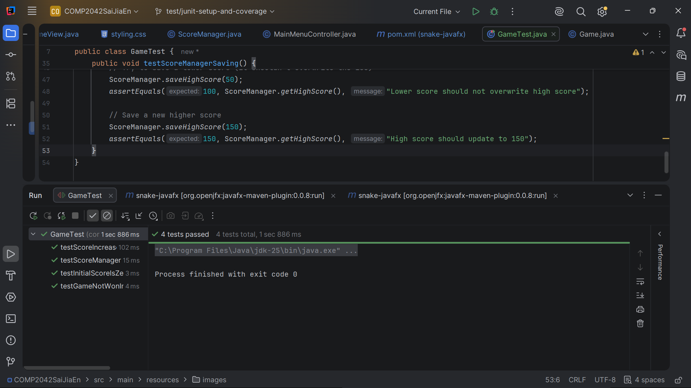

# COMP2042 Coursework - Snake Game

## GitHub
https://github.com/jiaen10/COMP2042SaiJiaEn

## Compilation Instructions
- **Java Version**: JDK 25
- **IDE Used**: IntelliJ IDEA
- **Dependencies**: JavaFX (managed via Maven)
- To compile and run the project, open the terminal in the project root directory and run:
  ```bash
  ./mvnw clean javafx:run

## Unit Testing Evidence
